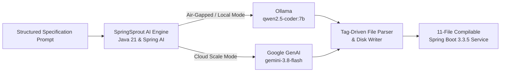

# 🌱 SpringSprout AI: Hybrid GenAI Enterprise Bootstrapper

An automated, enterprise-grade architecture accelerator designed to instantly generate multi-file, production-ready **Java 21** and **Spring Boot 3.3.5** microservices from structured natural language specifications using **Spring AI** with dual-model support (**Ollama `qwen2.5-coder:7b`** & **Google `gemini-3.8-flash`**).

---

## 💡 The Engineering Problem & Solution
Bootstrapping enterprise Spring Boot services involves significant repetitive setup—configuring Maven dependencies, bidirectional JPA relationships (`@OneToOne`, `@OneToMany`), Jackson serialization guards, custom business rule validators, and global exception handlers. **SpringSprout AI** translates detailed architectural prompts into clean, compilable 11-file project structures written directly to disk in seconds.

## 🏗️ Hybrid LLM Architecture



## ⚡ Real-World Example: Prompt to 11-File Microservice

**1. Input Specification:**
> *"Create a complete, working Spring Boot 3.3.5 CRUD web application for an enterprise 'Product' catalog utilizing Java 21, Spring Data JPA, SLF4J Logging, and an H2 In-Memory Database within base package `com.kani`—complete with bidirectional `@OneToOne` (`ProductDetail`) and `@OneToMany` (`ProductReview`) entities, `@JsonManagedReference`/`@JsonBackReference` serialization, custom category pricing/validation rules, and `@RestControllerAdvice` exception handling."*

**2. Generated Project Structure (Written Directly to Workspace):**
```text
product-service/
├── pom.xml                                                 # Java 21, Spring Boot 3.3.5, Web, JPA, Validation & H2
└── src/main/
    ├── java/com/kani/
    │   ├── SimpleCrudOperationApplication.java             # Entrypoint with SLF4J startup logging
    │   ├── controller/
    │   │   └── ProductController.java                      # REST endpoints (/api/products & nested reviews)
    │   ├── service/
    │   │   └── ProductService.java                         # @Transactional business logic & bidirectional sync
    │   ├── repository/
    │   │   └── ProductRepository.java                      # Spring Data JPA + custom ignore-case finder
    │   ├── model/
    │   │   ├── Product.java                                # Parent entity (@OneToOne & @OneToMany)
    │   │   ├── ProductDetail.java                          # One-to-One extension (@JsonBackReference)
    │   │   └── ProductReview.java                          # One-to-Many child entity (@JsonBackReference)
    │   ├── util/
    │   │   └── ProductBusinessValidator.java               # Category threshold rules & clearance discounts
    │   └── exception/
    │       └── GlobalExceptionHandler.java                 # @RestControllerAdvice (400 / 404 / 500 JSON responses)
    └── resources/
        └── application.properties                          # H2 console, dialect, DDL & SLF4J config
```

## ✨ Key Capabilities
* **Dual-Model Flexibility (Local + Cloud):** Seamlessly switch between 100% air-gapped local inference via **Ollama (`qwen2.5-coder:7b`)** for strict enterprise data privacy and **Google Gemini (`gemini-3.8-flash`)** for high-speed cloud generation.
* **Deterministic Multi-File Synthesis:** Enforces structured `[FILE: path]` boundary tags to parse and generate complete, zero-shortcut codebases (entities, repositories, validators, exception handlers, controllers, and `pom.xml`) without `// TODO` placeholders.
* **Enterprise JPA & REST Patterns:** Automatically wires bidirectional parent-child helper methods, Jackson recursion protection (`@JsonManagedReference` / `@JsonBackReference`), and `@Transactional` service boundaries.

## 🛠️ Tech Stack
* **Core Language:** Java 21
* **Framework:** Spring Boot 3.3.5, Spring Data JPA, Spring AI
* **Local Inference:** Ollama (`qwen2.5-coder:7b`)
* **Cloud Inference:** Google GenAI (`gemini-3.8-flash`)
* **Database & Build:** H2 In-Memory Database, Apache Maven

## 🔒 Source Code & Enterprise Inquiries
The core generation engine (`spring-sprout-ai-core`) is maintained in a private repository to protect proprietary prompt pipelines and file-parsing logic. For architecture walkthroughs, enterprise demos, or collaboration inquiries, feel free to connect via **LinkedIn**.
